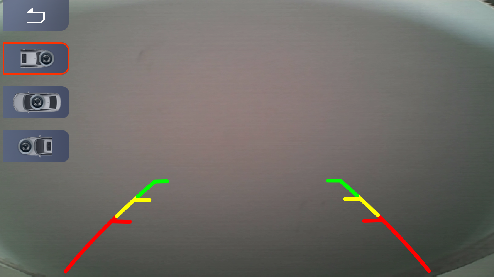

# headunit-carplay-voicekey

Two things an aftermarket Android head unit could already do but shipped without:

1. **Native wired Apple CarPlay**, using the Apple authentication chip already on the board. No dongle,
   no root.
2. **Steering-wheel voice button shortcuts**: single press for the front camera, double press for
   CarPlay, long press for Home. An ordinary app, no root, no system signing.

Worked out on a **BWIC "Yato1 B100"** unit (Autochips AC8257, Android 9, `OS_Yato1_B100_01_V2.00.23`).
The debloat, launcher, icons and widgets for the same unit are in
[clean-your-headunit-skill](https://github.com/ahmadbilaldev/clean-your-headunit-skill). Do that first:
it has the snapshot and the list of packages that must never be disabled.

Screenshots of CarPlay running are still to be added.

## 1. Wired CarPlay

### Credit and what differs

The method is from [riazosama/headunit-carplay](https://github.com/riazosama/headunit-carplay), written
for the sibling Yato1 A100 board. On the B100 it turned out simpler: **root was never needed**, because
the chip address was already right and every setting involved is writable from the ADB shell.

### Is the hardware there? Four read-only checks

```bash
adb shell 'pm list packages | grep -E "autochips.carplay"'      # the CarPlay service
adb shell 'getprop | grep -E "ro.atc.carplay|persist.carplay"'  # support=1, slave_addr, client.package
adb shell 'for i in 1 2 3; do i2cdetect -y -r 6 0x10 0x11; done' # the Apple MFi chip on bus 6
adb logcat -d | grep -E "MFICp|IAPAuth|Authentificate"           # the chip being read at boot
```

| Finding on the B100 | Value |
|---|---|
| `ro.atc.carplay.support` | 1 |
| `ro.atc.carplay.wireless` | 0 |
| `ro.atc.carplay.client.package` | `com.autochips.carplayapp`, which the firmware never shipped |
| MFi chip | Answers at `0x11` on `/dev/i2c-6`, matching `persist.carplay.i2c.slave_addr=17` |
| `carplay_on` | Unset in `global`, 0 in `system` |

So the service, the chip and the iAP stack were all present. Two things were missing: the switch, and
an app to draw the picture.

### Steps

```bash
# 0. Snapshot settings, properties and packages first.
# 1. Build the screen app from source, after reading it.
carplay/build-screen-app.sh /tmp/cpscreen
# 2. Install. Play Protect shows "Unsafe app blocked" on the unit because the app targets API 27:
#    the owner taps More details > Install anyway within about two minutes.
adb install /tmp/cpscreen/CarPlayScreen.apk
# 3. Switch CarPlay on, in both tables.
adb shell settings put global carplay_on 1
adb shell settings put system carplay_on 1
# 4. Real reboot: the CarPlay service only starts with the switch at boot.
adb reboot
# 5. Plug the iPhone into the unit's USB port, with any CarPlay dongle unplugged.
```

Undo: `pm uninstall app.carplayscreen`, `settings delete global carplay_on`,
`settings put system carplay_on 0`, reboot.

### What works

| Item | Status |
|---|---|
| Screen, 1280x720 | Works |
| Touch | Works |
| Maps and navigation prompts | Work; prompts play through CarPlay's own audio stream |
| Music | Plays over **Bluetooth**, with the unit's source set to BT Music |
| Auto-open on plug-in | The screen app's watcher does this; on the first boot it had to be opened by hand |
| Siri, calls | Not yet tested |
| Wireless CarPlay | Off. Needs root and an edit to `/vendor/build.prop`; not attempted |

### Things that got in the way

- **Flipping only `system carplay_on` does nothing**, and nothing happens at all until a reboot.
- **Other apps grab the iPhone.** A CarPlay-receiver app (DiPlay here) claimed the USB attach and the
  unit asked which app to open. Disable or remove such apps. The dongle app's USB filter
  (class 239 / subclass 2) also matches some built-in cameras.
- **No sound at first.** The iPhone stayed connected to the car's Bluetooth and played music there,
  while the unit sat on the AUX source. Opening BT Music fixed it. Choosing the CarPlay output in the
  iPhone's Control Center should move music onto CarPlay's own stream; untested.
- **The authentication log looks alarming.** Several `read 0x10 fail: Remote I/O error` lines appear
  before `Authentificate Success`. Those are register reads while the chip wakes up.

## 2. Voice button shortcuts

### How the button works

The button is not an Android key event; nothing reaches the normal input queue.

```
steering wheel -> MCU -> com.bw.car (CarInputService) -> registered listeners
```

Apps bind to the car service and register for specific key codes with a priority. The vendor voice app
(`com.bw.asr`) is the one registered for the voice key, and it only forwards to the TXZ assistant. With
TXZ disabled the button is dead.

The car service's binding has **no permission requirement**, so any app can register.

| Interface | Detail |
|---|---|
| Bind | component `com.bw.car/.CarService`, action `bw.car.ICar` |
| `bw.car.ICar` | transaction 2 = `getCarService(String)`; pass `"car_input"` |
| `bw.car.input.ICarInput` | transaction 2 = `registerInputListener(listener, int[] keys, int[] priorities)`, 3 = unregister, 4 = `injectKeyEvent` |
| `bw.car.input.ICarInputListener` | transaction 2 = `onKeyEvent(KeyEvent)` |
| Priorities | LOW 1, MIDDLE 2, HIGH 3, FACTORY 4 |

Key codes (`bw.car.input.CarKeyEvent`):

| Key | Code | Key | Code |
|---|---|---|---|
| VR (voice) | 1050 | VR_PHONE | 1054 |
| PHONE | 1053 | NAVI | 1046 |
| MODE | 1043 | MULTI_MUTE | 1044 |
| MEDIA | 1035 | BT_MEDIA | 1036 |
| FM / AM / FMAM | 1033 / 1034 / 1032 | SETUP | 1006 |
| POWER | 1010 | DISP / DIMMER | 1011 / 1012 |
| AVM | 1022 | CUSTOM_KEY0-5 | 1100-1105 |
| Two-finger swipes | 1200-1203 | Three / four-finger swipes | 1204-1207 / 1208-1211 |

Only the voice key was tested on a real car. The others come from the vendor code.

These were read out of the vendor apps with `dexdump` (`aapt2 dump xmltree` for manifests): the voice
app bundles the car client library, including the AIDL stubs with their transaction numbers.

### The app: `apps/voicekey/`

| Gesture | Action |
|---|---|
| Single press | Front camera |
| Double press (two within 350 ms) | CarPlay |
| Long press (600 ms, fires while held) | Home |

- `KeyService` binds to the car service, registers for key 1050 at high priority, and counts presses.
  It runs as a foreground service and starts at boot.
- `FrontTap` exists because the vendor camera app always opens on the reverse camera and has no way to
  ask for another one. It is an accessibility service scoped to `com.bw.adas`, armed for 15 seconds
  after a press. It taps the picture to reveal the three camera icons and presses the front one.

  

  The camera app ignores presses made before the picture is stable, and it disables the icon of the
  camera being shown. So the helper waits 1.5 s, then retries until `camera_front` is disabled.

```bash
apps/voicekey/build.sh /tmp/voicekey && adb install -r /tmp/voicekey/VoiceKey.apk
adb shell settings put secure enabled_accessibility_services dev.bilal.voicekey/dev.bilal.voicekey.FrontTap
adb shell settings put secure accessibility_enabled 1
adb shell am start -n dev.bilal.voicekey/.Start
adb logcat -s VoiceKey      # "registered for voice key", then one line per press
```

Undo: `pm uninstall dev.bilal.voicekey`, `settings delete secure enabled_accessibility_services`,
`settings put secure accessibility_enabled 0`.

To change the actions, edit `onVoiceKey`, `onDoublePress` and `onLongPress` in `KeyService.java`. To
handle another key, add its code to the array passed at registration.

Dead ends worth knowing: the camera service's `bw_start_camera` extra does nothing from outside, and a
single early click on the front icon is silently dropped.

## Safety

- Everything here is reversible with the undo lines above. Nothing was flashed and no system package
  was removed.
- This unit's ADB port is open to the whole Wi-Fi network with no authentication. Keep it off networks
  you do not control.
- The voice-key app can see only the keys it registers for, and its accessibility service is limited
  to the camera app.

## Use the skill

```bash
git clone https://github.com/ahmadbilaldev/headunit-carplay-voicekey
cp -r headunit-carplay-voicekey/headunit-carplay-voicekey ~/.claude/skills/
```

Then ask Claude Code to "enable CarPlay on my head unit" or "remap my steering wheel voice button".

MIT licence. The CarPlay screen app is built from riazosama/headunit-carplay, also MIT.
